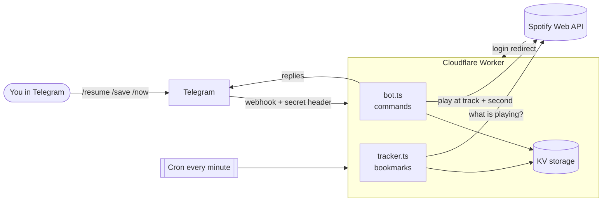
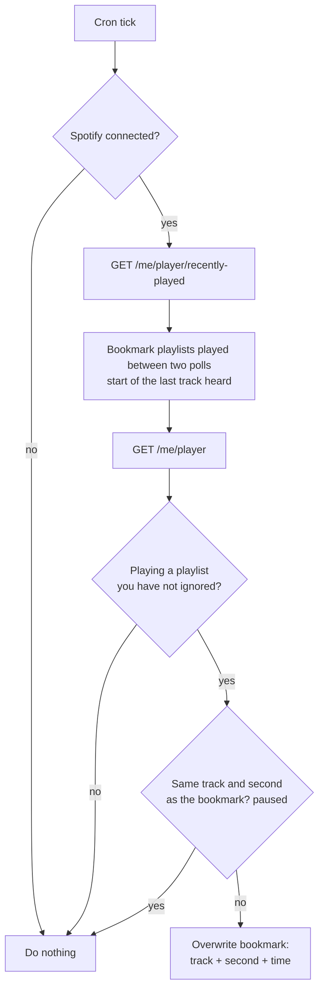
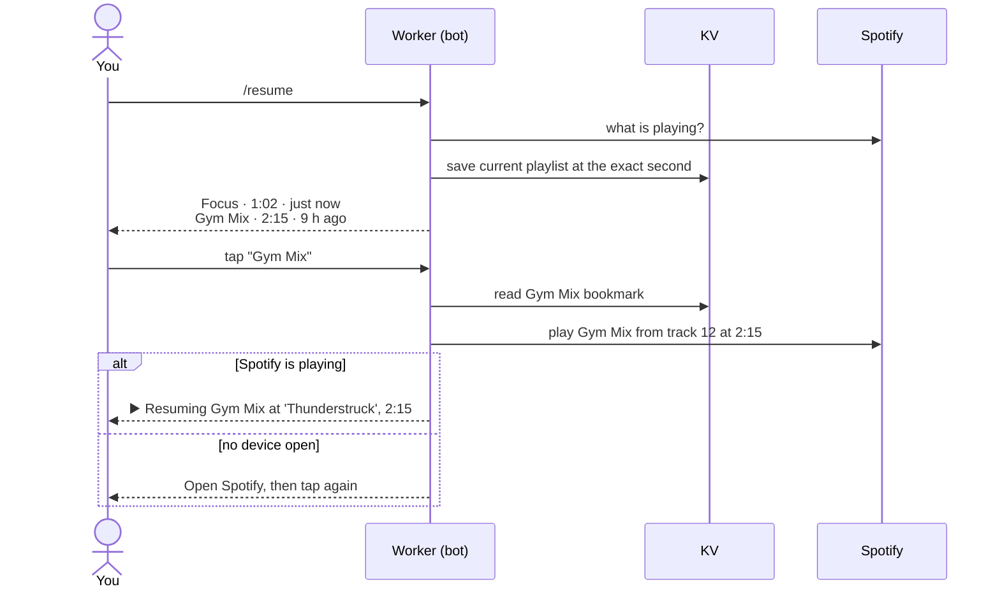

# playlistBookmark

A personal Telegram bot that remembers where you left off in every Spotify playlist and resumes it from that exact song and second, on any device. It runs on Cloudflare's free tier, so there is no PC or server of yours to keep on.

```powershell
# PowerShell (Windows, or pwsh on macOS/Linux)
irm https://raw.githubusercontent.com/adrianhruiz/playlistBookmark/main/install.ps1 | iex
```

```bash
# bash / zsh (macOS, Linux, WSL)
curl -fsSL https://raw.githubusercontent.com/adrianhruiz/playlistBookmark/main/install.sh | bash
```

Then follow [Setup](#setup).

## Why

Spotify resumes podcasts and audiobooks, but not music playlists. Switch from playlist A to B, and when you come back to A it starts over. playlistBookmark keeps one bookmark per playlist and puts you back where you were with one tap.

## How it works

One Cloudflare Worker does everything. It only wakes up once a minute and whenever you message the bot.



| Entry point | Triggered by | What it does |
|-------------|--------------|--------------|
| Cron `* * * * *` | Cloudflare | Reads what you are playing and overwrites that playlist's bookmark |
| `POST /telegram` | Telegram, on every message | Runs the command and replies |
| `GET /callback` | Spotify, after you log in | Stores the token that lets the bot read and control playback |

### The tracker, every minute



It follows your **account**, not a device: switch from phone to laptop and the bookmark keeps up.

### Resuming a playlist



## Using it

**Once:** send `/start`, tap **Connect Spotify**, accept. The bot answers *"✅ Connected. Tracking your playlists."*

**Every day:** listen as usual, and open the bot only to go back.

| Command | What it does |
|---------|--------------|
| `/resume` | Lists your bookmarked playlists. Tapping one saves the current playlist at the exact second, then resumes the chosen one. |
| `/save` | Saves the current playlist at the exact second (use it before switching in the Spotify app). |
| `/now` | Shows what is playing, at which second, and on which device. |
| `/untrack` | Stops following a playlist: deletes its bookmark and ignores it from then on. |
| `/track` | Follows an ignored playlist again. |

## Requirements

| What | Why | Cost |
|------|-----|------|
| [Node.js](https://nodejs.org) 22.12+ and npm | Build, test and deploy with Wrangler | Free |
| [git](https://git-scm.com/downloads) | The installer clones the repository | Free |
| [Cloudflare account](https://dash.cloudflare.com/sign-up) | Hosts the Worker, cron and KV storage | Free tier |
| [Spotify Premium](https://www.spotify.com/premium/) account | Spotify requires Premium to create a Development Mode app (since February 2026) and to control playback | Paid |
| Telegram account | Talk to your bot | Free |

npm dependencies (dev only, nothing ships at runtime): `wrangler`, `typescript`, `vitest`, `@cloudflare/workers-types`.

## Setup

The installer clones the repo, runs `npm ci`, and creates `.dev.vars` from `.dev.vars.example`. To do it by hand:

```bash
git clone https://github.com/adrianhruiz/playlistBookmark.git
cd playlistBookmark
npm ci
cp .dev.vars.example .dev.vars
```

### 1. Cloudflare: get your URL

```bash
npx wrangler login
npx wrangler kv namespace create KV   # replace the "id" in wrangler.jsonc with the one printed
npm run deploy                         # prints https://playlistbookmark.<subdomain>.workers.dev
```

That URL is your `BASE_URL`. The Worker is safe to deploy before the secrets exist: the webhook rejects every call and the cron stays idle.

### 2. Spotify: Client ID and Client Secret

1. Open the [Developer Dashboard](https://developer.spotify.com/dashboard) with your Premium account and click **Create app**.
2. Redirect URI: `<BASE_URL>/callback`. API: **Web API**.
3. Copy the **Client ID** and **Client Secret** from **Settings**.

### 3. Telegram: bot token

Message [@BotFather](https://t.me/BotFather), send `/newbot`, and copy the token.

### 4. Fill in `.dev.vars` and upload the secrets

| Variable | Value |
|----------|-------|
| `SPOTIFY_CLIENT_ID` | From step 2 |
| `SPOTIFY_CLIENT_SECRET` | From step 2 |
| `TELEGRAM_BOT_TOKEN` | From step 3 |
| `TELEGRAM_WEBHOOK_SECRET` | Any random string: `openssl rand -hex 32` |
| `BASE_URL` | From step 1, without a trailing slash |

```bash
npx wrangler secret put SPOTIFY_CLIENT_ID      # repeat for each variable above
```

`.dev.vars` is git-ignored. Never commit secrets.

### 5. Connect Telegram and start

```bash
npm run setup:telegram   # registers the webhook with its secret and the command menu
```

Send `/start` to your bot. The first private chat that does it owns the bot; everyone else is ignored.

## Development

```bash
npm test            # unit tests, offline (fake Spotify, Telegram and KV)
npm run typecheck
npm run dev         # local Worker; trigger the cron at /__scheduled
```

With npm 11+, `npm run dev` needs the `workerd` install script: run `npm install-scripts approve workerd` once.

| File | Role |
|------|------|
| `src/index.ts` | Worker entry: routes and cron |
| `src/tracker.ts` | Cron logic: one bookmark per playlist, recovery from recently-played |
| `src/bot.ts` | Telegram commands |
| `src/spotify.ts` | Spotify Web API and OAuth tokens |
| `src/telegram.ts` | Telegram Bot API |
| `src/store.ts` | KV records: bookmarks, ignored playlists, owner, OAuth state |
| `scripts/telegram-setup.mjs` | Registers the webhook and command menu |

## Security

- Telegram calls must carry `X-Telegram-Bot-Api-Secret-Token`; without a configured secret the webhook rejects everything.
- Only the owner's private chat can run commands or complete the Spotify login.
- The OAuth `state` is random, single-use, and expires in 10 minutes.
- Spotify tokens live only in KV; credentials live only in Cloudflare secrets and your local `.dev.vars`.

## Known limits

| Limit | Why | Mitigation |
|-------|-----|------------|
| Up to ~1 min of position lost when you switch playlists in the Spotify app | The cron polls once a minute | Switch with `/resume`, or send `/save` first |
| A playlist played for less than 1 min resumes at the start of its last track | It started and stopped between two polls | `recently-played` recovers it at track level |
| Shuffle: the right song resumes, but the following order differs | The API does not expose the full queue | None |
| `/resume` needs Spotify open on some device | Spotify needs an active device to play | The bot asks you to open Spotify and retry |
| About 1 KV write per minute while music plays | KV free tier allows 1,000 writes per day (~16 h of listening) | Writes are skipped while paused |
| One owner per deployment | It is a personal bot | Delete the `owner:chat_id` KV key to reset |

## Tech stack

TypeScript · Cloudflare Workers · Wrangler · KV · Spotify Web API · Telegram Bot API
